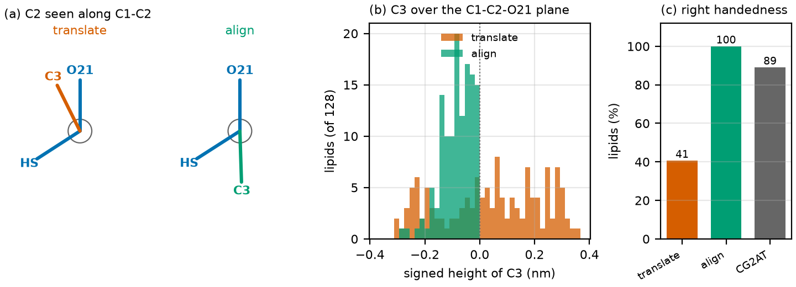

# Fragment orientation

`backmap-prep` places one atomistic fragment on every CG bead. By default a fragment is only
*translated* onto its bead: it keeps the orientation it had in the source molecule. That is
enough when each fragment contains the geometry that matters, but it leaves the **relative
orientation of neighboring fragments** to chance, which matters wherever a stereocenter or a
rigid unit spans two beads.

`prep.fragment_orientation: align` rotates every fragment so that it fits its neighbors.

```yaml
prep:
  fragment_orientation: align   # default: translate
```



*(a) The glycerol carbon C2 of a MARTINI 3 POPC lipid, seen along the C1-C2 bond. Three of its
four neighbors (C1, O21, HS) are in one fragment and the fourth (C3) in the next. Translation puts
C3 on the wrong side for this lipid; alignment puts it on the right side. (b) Signed height of C3
over the plane through C2, C1, and O21 for the 128 lipids of the bilayer, before any dynamics.
(c) Share of lipids with the handedness of the source molecule. The independent CG2AT bilayer
used as reference in the paper has 89 %.*

## What it does

For every residue, the builder

1. compares the vectors between the centers of mass of bonded fragments in the source molecule
   with the vectors between the CG beads, and takes the proper rotation (Kabsch, determinant +1,
   so a fragment is never mirrored) that makes them agree;
2. refines each rotation with the covalent bonds that join fragments: an atom bonded to a
   neighboring fragment should lie where that fragment, rotated, puts it;
3. checks every stereocenter whose neighbors lie in two fragments. If the placed geometry has
   the opposite handedness to the source molecule, the fragment gets the best-fitting
   orientation, among 2000 trial rotations, that restores it.

Fragments are rotated rigidly about their bead, so the CG bead positions and the internal
geometry of every fragment are unchanged. Beads without a bonded neighbor in the same residue
(for example a MARTINI water bead) are not rotated. Fragments cut from different source chains
are not compared.

## When to use it

Use `align` when a stereocenter, a ring, or a double bond has atoms in two beads, as in lipids
(glycerol, cis double bonds) and residues split across beads. For linear polymers whose fragments
are self-contained, `translate` gives the same structure after the ramp and keeps the output
identical to earlier releases, which is why it is the default.

## Limits

- Handedness is taken from the **source molecule**; the CG model carries no chirality, so a
  molecule of the opposite handedness needs its own source structure.
- The orientation fixes the placement only. Whether a geometry survives the hybrid run depends
  on the transient of the ramp (see the ramp-length discussion in the paper).
- A stereocenter is detected from the source geometry (atoms closer than 0.19 nm are bonded) and
  only when its neighbors lie in two fragments of one residue.
